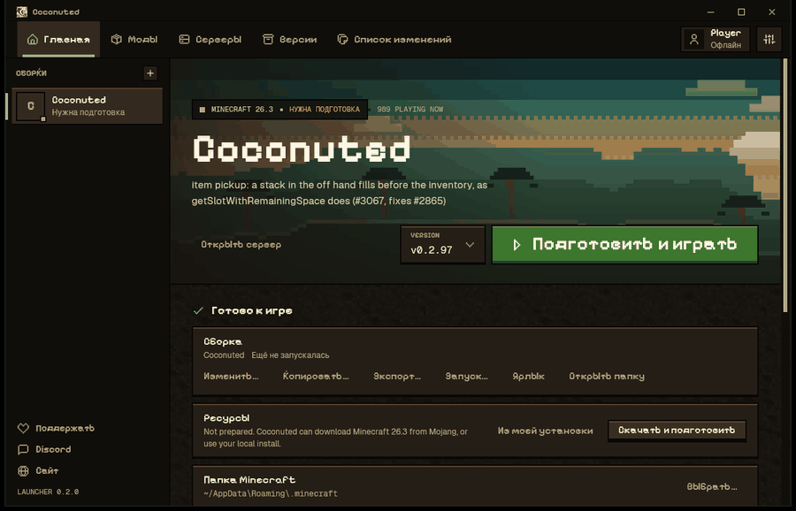
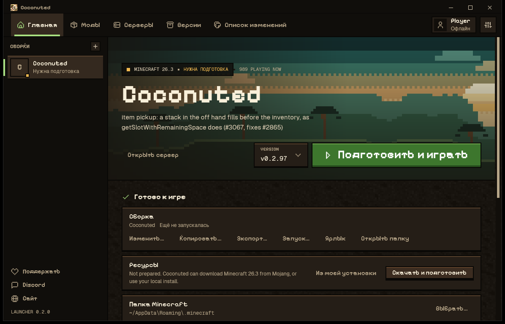
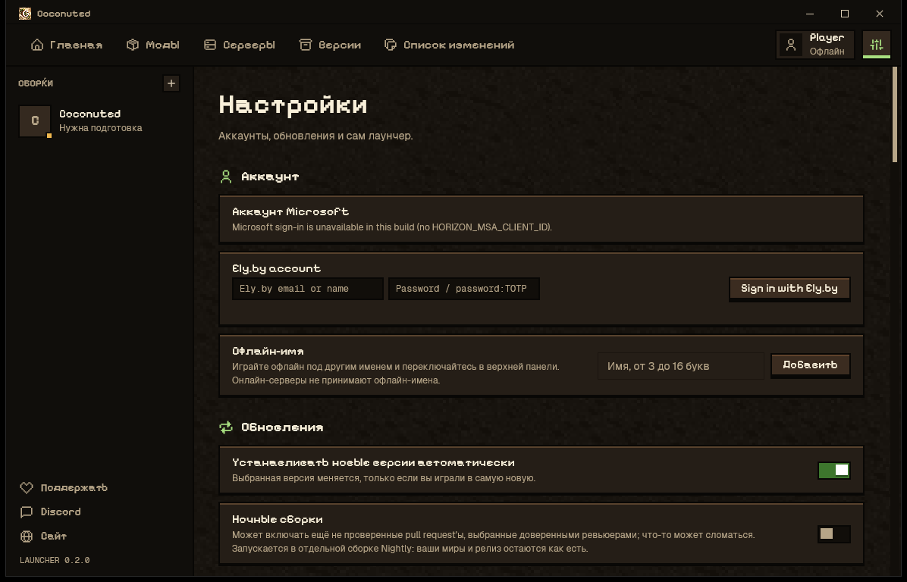
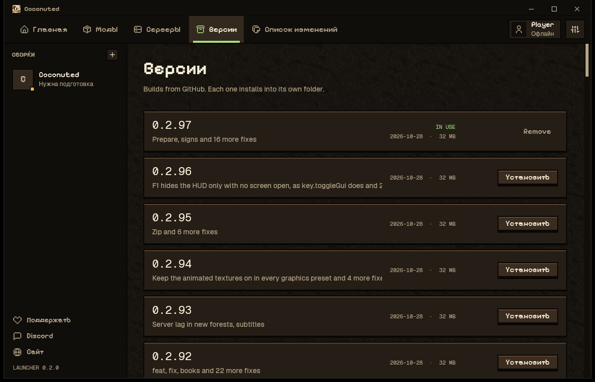

# Coconuted Launcher

Coconuted Launcher is a Windows launcher and client fork of [Horizon](https://github.com/horizon-rust/horizon). It supports local names and Ely.by accounts. The matching client in this repository handles Ely.by server authentication.

[Download the Windows launcher](https://github.com/getsicked/Coconuted-Launcher/releases/latest)

## Preview



### Home screen



### Accounts and versions





## Build on Windows

Install the stable Rust toolchain and the Windows C++ build tools. Build both programs from the same commit:

```powershell
cargo build --profile fast -p horizon-client --bin horizon-client
$env:COCONUTED_CLIENT_EXE = (Resolve-Path 'target/fast/horizon-client.exe').Path
cargo build --release --manifest-path launcher/Cargo.toml
```

The launcher embeds the matching client and extracts it to its application data folder when the game starts. The output file is `launcher/target/release/horizon-launcher.exe`; it can be named `Coconuted Launcher.exe`.

## Accounts

In Settings → Account, sign in to Ely.by or choose a local name. Ely.by sign-in stores session tokens in the operating system keychain. A local name does not authenticate on online-mode servers. Microsoft online-mode servers require a Microsoft account with Minecraft: Java Edition.

## Source and licensing

This fork is based on Horizon and retains its MIT license. See [LICENSE](LICENSE) and [THIRD_PARTY_NOTICES.md](THIRD_PARTY_NOTICES.md). It is unofficial and is not associated with Mojang, Microsoft, or Ely.by. Minecraft game files and assets are not included; the launcher obtains or prepares them on the user's machine.
